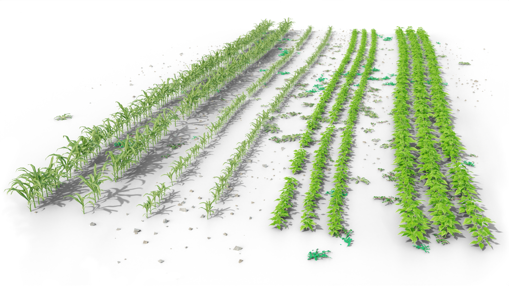

# CropCraft

CropCraft is a python script that generates 3D models of crop fields, specialized in
real-time simulation of robotics applications.



* Designed for real-time simulation
* Suitable for use with LiDARs and cameras
* Highly configurable (YAML file)
* Provide ground truth data (identify plant types in LiDAR data)


## Requirements

This program uses blender as a backend.
It is a 3D modeling software that you can dowload from the
[official website](https://www.blender.org/download/).
If you use Ubuntu, you can install it using snap:
```
snap install blender --classic
```
The minimal required version is `4.0`.
Ensure that blender is launchable from the command line.
It means that blender must be accessible using the `PATH` environment variable.

If Blender is not in your `PATH`, you can optionally set the `CROPCRAFT_BLENDER`
environment variable to the path of the Blender executable:
```
CROPCRAFT_BLENDER=/path/to/blender python cropcraft.py examples/test1.yaml
```
When this variable is not set, CropCraft uses `blender` from the `PATH`.

You also need to install some python requirements:
```
pip install -r requirements.txt
```

## Running

To generate a crop field, you first need to create a configuration file (YAML formats).
Some examples are available in the [`examples`](/examples) directory.
Then you can execute the `cropcraft.py` script and specify the path of the chosen configuration
file.
```
python cropcraft.py examples/test1.yaml
```
This command will generate a blender file named `test1.blend` and a gazebo model named `test1`

Some options are available and described using
```
python cropcraft.py --help
```

## Image capture

CropCraft can render a dataset of paired RGB images and semantic segmentation masks by adding a
`render` block to your configuration file:

```yaml
render:
  directory: render       # output subdirectory (relative to --output-dir)
  frames: 1               # maximum number of frames to render
  samples: 32             # number of CYCLES samples per pixel (RGB pass)
  camera:
    height: 1.6           # camera height above the ground (meters)
    fov_deg: 60.0         # horizontal field of view (degrees)
    roll_deg: 0.0         # X-axis rotation in degrees (XYZ Euler order)
    pitch_deg: 0.0        # Y-axis rotation in degrees
    yaw_deg: 0.0          # Z-axis rotation in degrees
    y_jitter: 0.1         # random lateral offset per frame (meters)
  label_colors:           # RGB colors for semantic mask classes (optional)
    crop:       [0, 255, 0]
    weed:       [255, 0, 0]
    background: [0, 0, 0]
```

When a `render` block is present, CropCraft renders two passes in a single run:

1. **RGB images** — rendered with Cycles, saved as JPEG in `<directory>/images/`
2. **Semantic masks** — rendered with EEVEE using flat emission materials,
   saved as PNG in `<directory>/masks/`
   - Crops → `label_colors.crop` (default: green `[0, 255, 0]`)
   - Weeds → `label_colors.weed` (default: red `[255, 0, 0]`)
   - Ground / stones → `label_colors.background` (default: black `[0, 0, 0]`)

> **Note:** when using `cycles_device: GPU`, the desired GPU must be enabled in Blender
> beforehand. Open Blender and go to **Edit > Preferences > System > Cycles Render Devices**,
> then select your GPU. This setting persists across runs. (Verified on Blender 5.0.1.)

See [`examples/render_example.yaml`](examples/render_example.yaml) for a complete example.

## Documentation

* [Description of the configuration file format](doc/configuration_format.md)
* [How to add your own assets](doc/add_assets.md)
